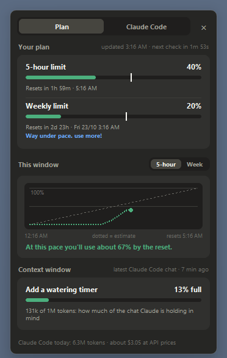

# Claude usage pet

  
  
  
  
  

A tiny pixel Claude that lives on your Windows taskbar and keeps an eye on your Claude plan for you.

The bubble over its head shows how much of your **5-hour** and **weekly** limits you've used (these cover claude.ai, the desktop app and Claude Code together). Hover over it for the details. While Claude Code is working, it puts on a wizard hat and acts out what Claude is doing.

If the pet makes you smile, a ⭐ on GitHub helps other people find it.

## Quick start

1. Install **Python** from [python.org](https://www.python.org/downloads/windows/).
2. Make sure **Claude Code** is installed and signed in on this computer.
3. Download the [latest release](https://github.com/have-you-tried-restarting/claude-usage-pet/releases/latest) (**Source code (zip)**), unzip it, and double-click **`Start pet.bat`**.

That's it: no terminal and no extra installs. The full steps are below if you need them.

## What it does

**Your usage at a glance.** The bubble rings yellow, then red, as you near a limit, and it warns you early if your pace would run out before the reset. Hover over the mascot for reset times, a chart of the current window and a forecast. A tray icon by the clock shows the same numbers.

**Claude Code stats.** How full your latest Claude Code chat's context window is (in the bubble and on the Plan tab), with a reminder of what `/compact` and `/clear` do once it's getting full. A Claude Code tab with token counts, models, projects, an activity grid, and a recap of each session when it finishes. All of it is read from Claude Code's logs on your own computer.

**Wizard mode.** While Claude Code works, the mascot casts a spell to match the tool it's using. It gets little apprentices when several sessions run at once.

**A pet with a personality.** It walks the taskbar, hops between monitors and onto your windows, naps when you're away, and gets bored when you ignore it. Then it finds something to do.

**Play with it.** Click it to poke it. Drag it around (it dangles from where you grab it), or throw it: it screams, bounces, and opens a parachute on long falls. Right-click it for a game of fetch, an hour of quiet, settings and more. Click the tray icon, or press Ctrl + Alt + H, and it comes running to your mouse.

**Dressed for the day.** It wears outfits on special days and pajamas at bedtime, and once in a while it wakes up a rare colour.

**Yours to tune.** Everything can be switched off, from sounds and chatter to all animations. The settings window explains every option.

Also: optional sound effects and desktop notifications, quiet hours (it follows Windows' Do Not Disturb), hiding during full-screen apps, and keyboard shortcuts (Ctrl + Alt + P hides or shows it, Ctrl + Alt + D pins the details panel; you can change them).

## What you need

- **Windows 10 or 11.** It's tested on Windows 11.
- **Python 3.10 or newer** from [python.org](https://www.python.org/downloads/windows/), including tkinter (the part that draws windows). The newest Python from python.org has everything it needs. It's tested on Python 3.14 and 3.15. There's no `pip install`: it only uses Python's standard library.
- **Claude Code**, installed on the same computer and signed in with your Claude account (Pro or Max). The pet reads your usage through Claude Code's saved login. Being signed in only to claude.ai or the desktop app isn't enough, and neither is a Claude Code API key.

## Install and start it

No terminal needed.

1. **Install Python.** Go to [python.org/downloads/windows](https://www.python.org/downloads/windows/), download the newest version and run the installer. If it shows a "tcl/tk and IDLE" option, leave it ticked. Skip the Microsoft Store version of Python.
2. **Download the pet.** Open the [latest release](https://github.com/have-you-tried-restarting/claude-usage-pet/releases/latest) and click **Source code (zip)** under Assets.
3. **Unzip it** somewhere you'll keep it, such as your Documents folder: right-click the ZIP, choose **Extract All**, and pick the folder. Avoid `Program Files`, because the pet saves its settings in its own `data` folder and can't write there.
4. **Start it.** Open the extracted folder and double-click **`Start pet.bat`**. The mascot appears on your taskbar.
   - The first time, Windows may warn about a file from the internet. Click **Run** (or **More info → Run anyway**) to go ahead.
   - If Python is missing, a window says so and opens the download page. If your Python is too old or is missing a part, a pop-up says what to fix.
5. **Optional:** to start it whenever you sign in to Windows, right-click the mascot, open **Settings → System**, and turn on **Start with Windows**.

To stop it, right-click the mascot and choose **Quit**. To update it, download the newest release and unzip it over the old folder; your settings in `data` are kept.

If you use a terminal, `py claude_pet.py` runs it with a console window that shows errors as they happen.

## If something goes wrong

- **The bubble says "no login" or "login expired":** open Claude Code and sign in again. Hover over the mascot for step-by-step help.
- **The bubble says "slow down":** the usage service asked the pet to wait. It tries again on its own; your last numbers stay on screen.
- **The bubble says something else ("service down", "offline", "no answer"...):** hover over the mascot. The panel says what went wrong, what usually causes it, and when it'll try again.
- **Nothing appears:** check whether it's hidden by pressing Ctrl + Alt + P. Otherwise, `data/pet_errors.log` in the pet's folder says what went wrong.
- **"Start with Windows" stopped working after a Python update:** turn it off and on again in Settings → System.

Still stuck? [Open an issue](https://github.com/have-you-tried-restarting/claude-usage-pet/issues/new/choose).

## Privacy and security

- The pet reads your Claude Code login from `~/.claude/.credentials.json` on your computer. It sends it **only** to `https://api.anthropic.com`, to ask for your usage numbers. It never prints, logs or saves it anywhere else.
- It reads Claude Code's logs (`~/.claude/projects`) for the stats, but only numbers, times, model names and project folder names. It never reads what you or Claude wrote. Nothing from the logs leaves your computer.
- It never sends messages to Claude, so it doesn't use up your plan.
- Everything it saves stays in its own `data` folder. Its error log replaces your user folder with `~`, so it's safe to paste into a bug report.

See [SECURITY.md](SECURITY.md) for how to report a security problem privately.

## Good to know

- The usage numbers come from an **undocumented** endpoint (`/api/oauth/usage`), so this could stop working at any time without notice.
- This is an unofficial fan project. It isn't affiliated with or endorsed by Anthropic. "Claude" and the Claude Code mascot design belong to Anthropic.

## Contributing

Bug reports and ideas are very welcome: please [open an issue](https://github.com/have-you-tried-restarting/claude-usage-pet/issues/new/choose). This project doesn't take code changes from outside, but you're free to fork it under the licence. See [CONTRIBUTING.md](CONTRIBUTING.md).

How everything works, in detail, is in [docs/PROJECT_NOTES.md](docs/PROJECT_NOTES.md), and what changed in each version is in [docs/CHANGELOG.md](docs/CHANGELOG.md).

## Licence

The code is under the [MIT licence](LICENSE). That covers this project's code only: the Claude name and the Claude Code mascot design belong to Anthropic.

If the pet makes you smile, a ⭐ on GitHub helps other people find it.
